# UNT Lost & Found

A mobile app concept that helps University of North Texas students report lost or found items, search existing reports, review possible matches, and mark items as resolved.

**Team:** Find my  
**Course:** CSCE 3444 · UI Design  
**Deliverable:** Mobile app wireframe and UI prototype (11 screens)

[View the Figma Make prototype](https://www.figma.com/make/snLN5CBd0a4DqMUTowUWkI/UNT-Lost---Found-App-Wireframe)

---

## Overview

Students lose items across a large campus, and found items often have no clear path back to their owners. UNT Lost & Found gives students one place to:

- Report a **lost** item or a **found** item with the same simple form
- **Browse and search** every active report
- See **possible matches** side by side with their own report
- **Manage** their reports and mark them **resolved**

## Features

| Feature | Description |
| --- | --- |
| Login and sign-up | UNT email (`@my.unt.edu`) and password, with a confirm-password field on sign-up |
| Home dashboard | Large buttons for Report Lost, Report Found, Browse Items, Possible Matches, My Reports, and Settings, plus a Log Out button |
| Report Lost / Found | Item name, category, description, location, date, approximate time, and optional photo |
| Browse and search | Search bar and filters, with item cards showing a LOST or FOUND label |
| Item details | Photo area, status, category, description, location, date, and approximate time |
| Possible matches | Your report next to a potential match, with a match percentage and "This is mine!" / "Not a match" actions |
| My Reports | Filter by All, Lost Items, or Found Items; each card shows an ACTIVE or RESOLVED label |
| Confirmation | Success message, report summary, and a possible-match notice |
| Settings | Account information, notification toggles, and About |

## Screens

| | | | |
| :---: | :---: | :---: | :---: |
| 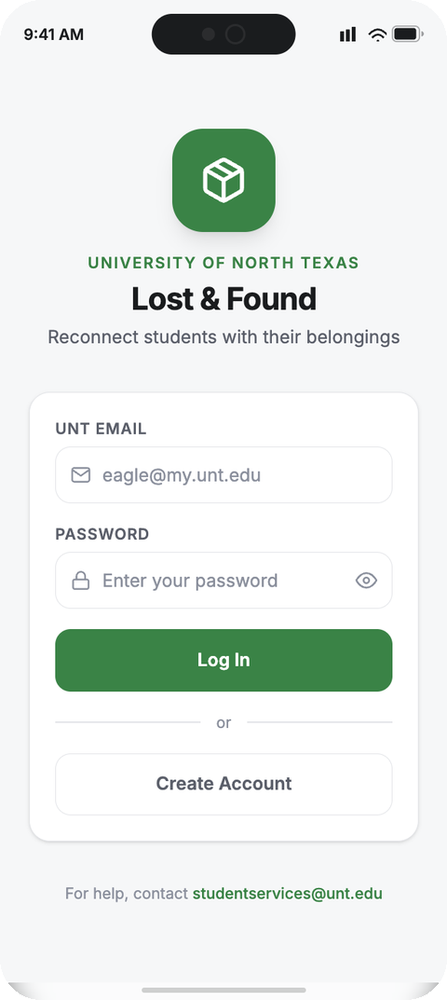<br>**1. Login** | 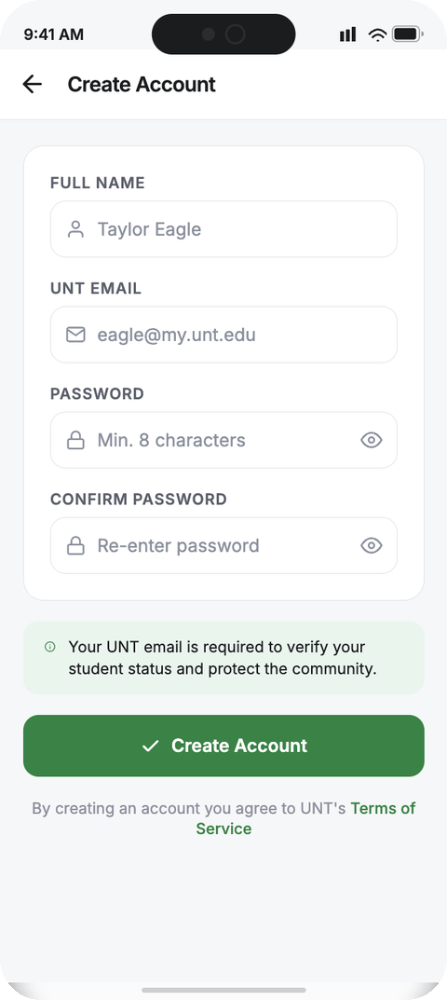<br>**2. Create Account** | 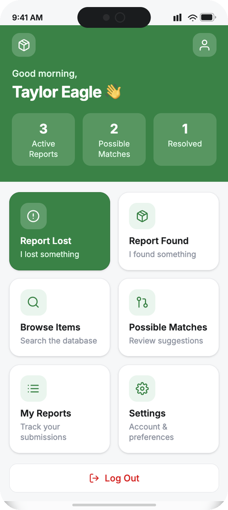<br>**3. Home** | 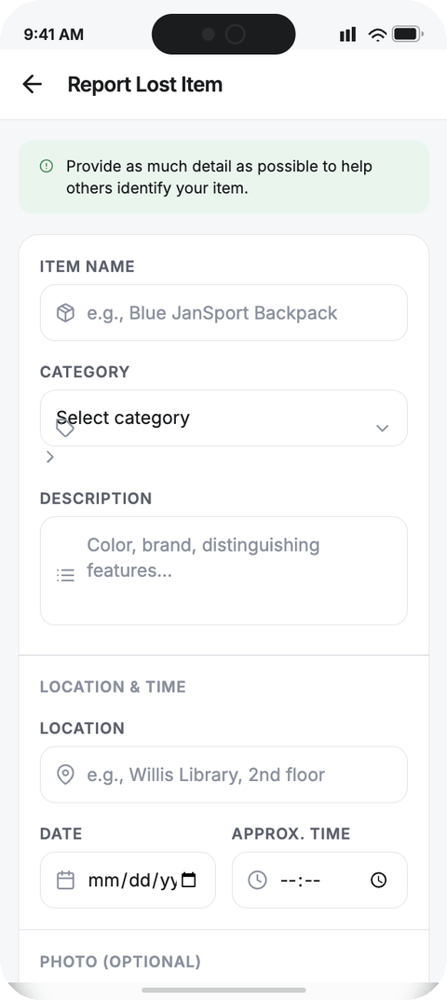<br>**4. Report Lost** |
| 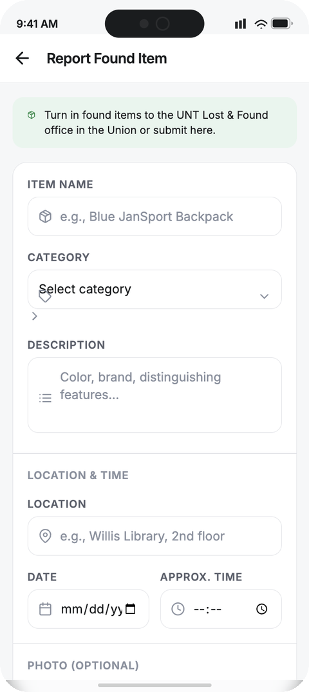<br>**5. Report Found** | 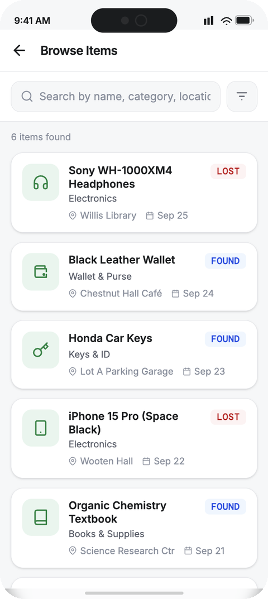<br>**6. Browse** | 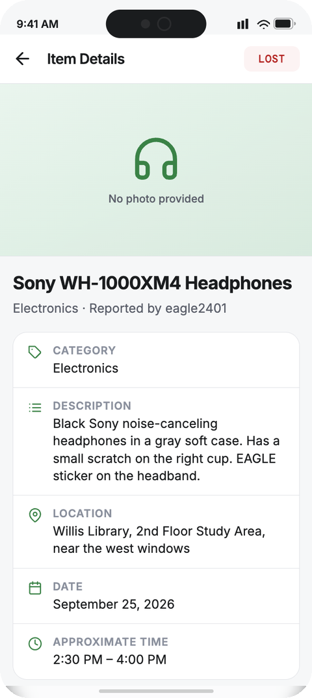<br>**7. Item Details** | 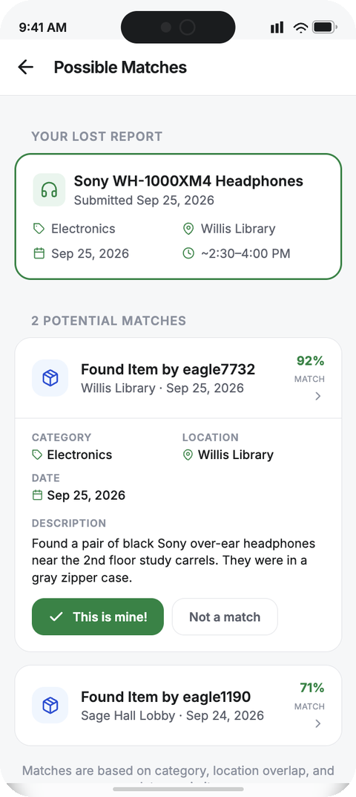<br>**8. Possible Matches** |
| 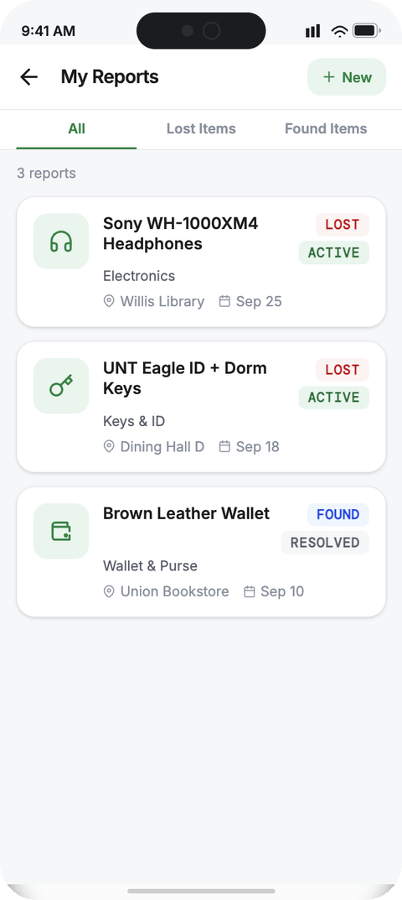<br>**9. My Reports** | 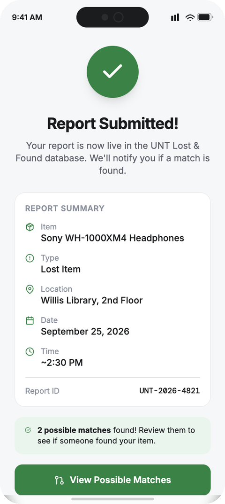<br>**10. Confirmation** | 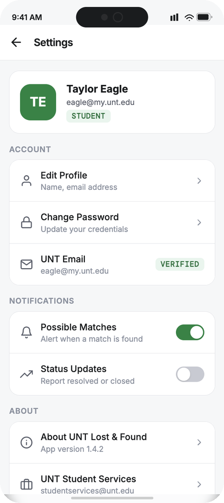<br>**11. Settings** | |

## User flow

```
Login ─► Home ─┬─► Report Lost ───┐
               ├─► Report Found ──┴─► Confirmation ─► Possible Matches
               ├─► Browse ─► Item Details ─► Possible Matches ─► My Reports (Resolved)
               ├─► Possible Matches
               ├─► My Reports
               └─► Settings ─► Log Out
Create Account ─► Home
```

## Design principles

- **Not color alone:** every status uses a text label as well as color (LOST, FOUND, ACTIVE, RESOLVED).
- **Error prevention:** visible field labels, format hints (such as the UNT email domain), and a password rule shown up front.
- **Clear feedback:** a success checkmark and report summary after submitting.
- **Recognition over recall:** the main actions are always visible on Home, and filters stay on screen.
- **Consistent UI:** a UNT-inspired green, white, and dark gray palette, rounded cards, and the same button and form styles throughout.

## Repository contents

```
unt-lost-found/
├── README.md
├── docs/
│   ├── UNT_Lost_and_Found_Wireframe.pdf    # 15-page wireframe and design document
│   └── UNT_Lost_and_Found_Wireframe.pptx   # editable version (native shapes and text)
└── screenshots/                            # the 11 final app screens
```

The PDF includes a design system page, a prototype flow map, an overview of the final screens, and one page per screen. Each screen page shows the wireframe next to the final app screenshot, with its purpose, navigation, and UX notes.

## Team

| Name | Role |
| --- | --- |
| Mufaro Ngwenya | _Add role_ |
| Raul Karki| _Add role_ |
| Jakolby King | _Add role_ |
| Osaivbie Obaje | _Add role_ |

## Course

CSCE 3444 · UI Design, University of North Texas.

## Notes

This is a design prototype with sample data (for example, "Taylor Eagle" and the Willis Library headphones report). It is not affiliated with or endorsed by the University of North Texas.
